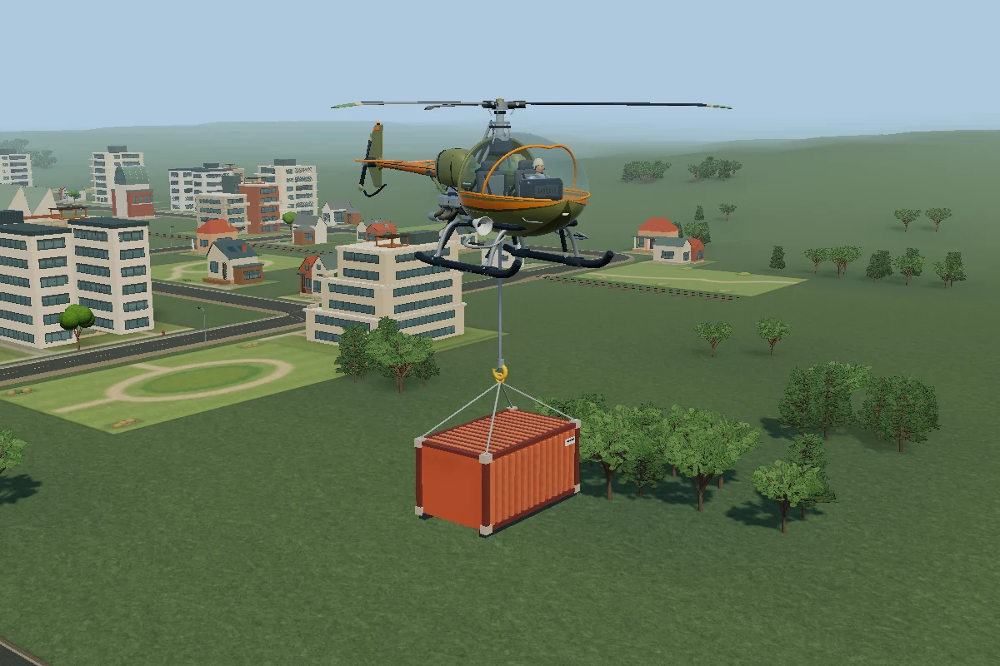

# 해온 항공구조대 · Haeon Air Rescue

헬기를 몰고 도시의 응급 신고에 출동하는 비영리 팬게임입니다. 강에서 양동이에 물을 채워 화재를 진압하거나, 환자를 병원 옥상에 내려 주고, 임무 보상으로 기체와 장비를 구입할 수 있습니다. 도시의 크기와 시드에 따라 강과 교량, 도로, 출동 현장이 달라집니다.

**[브라우저에서 바로 비행하기](https://abelagome-wq.github.io/haeon-air-rescue/)** · 격납고에서 **근무 시작**을 누르세요. 키보드, Xbox 패드, 모바일 터치를 지원합니다.

화물 수송은 기본 기체로도 시작할 수 있습니다. 격납고 장비 메뉴에서 **화물 고리**를 장착하고, 출동 목록에서 **화물 수송**을 고르세요. 컨테이너 위에서 줄을 내리고 고리를 연결한 뒤 목적지의 노란 원 안에 내려놓고 해제하면 운송료를 받습니다. 양동이와 같은 조작을 씁니다. 키보드는 **Z**로 줄 전환, **B**로 연결·해제, **X**로 하방 시점입니다. Xbox 패드는 고리를 선택한 뒤 **방향패드 ↓ / A / 오른쪽 스틱 클릭**, 터치는 화면의 줄·고리·하방 시점 버튼을 사용하세요.



## 로컬에서 v25 실행

GitHub Pages는 [gh-pages 브랜치](https://github.com/abelagome-wq/haeon-air-rescue/tree/gh-pages)의 게임과 자산을 직접 제공합니다. 전체 배포본을 PC에서 실행하려면 이 브랜치를 받아 최상위 폴더에서 `python -m http.server 8000 --bind 127.0.0.1`을 실행하세요.

개발용 `main` 브랜치는 게임 코드, Blender 편집본과 직접 제작한 자산을 담고 있습니다. 이 브랜치에서 개발하려면 아래 도구로 보관 중인 **해온 항공구조대 Windows v25 ZIP** 또는 압축을 푼 게임 폴더에서 나머지 자산을 가져올 수 있습니다.

Python 3.9 이상으로 저장소의 최상위 폴더에서 실행합니다. 첫 번째 명령의 경로를 실제 ZIP 또는 폴더 경로로 바꾸세요.

```sh
python tools/import_v25_assets.py "/path/to/Haeon-Air-Rescue-Windows11-20261109-v25.zip"
python tools/import_v25_assets.py --verify
python -m http.server 8000 --bind 127.0.0.1
```

[로컬 격납고](http://127.0.0.1:8000/)를 열어 도시 규모와 기체를 고른 뒤 **근무 시작**을 누릅니다. 브라우저에서 WebGL 2가 활성화되어 있어야 합니다. 가져오기 도구는 v25 목록에 있는 자산의 SHA-256을 검사하며, 이미 수정한 파일은 덮어쓰지 않습니다. 저장된 경력은 브라우저와 접속 주소별로 관리됩니다.

Windows 11에서 독립 창으로 실행하려면 자산을 먼저 복원한 뒤 `remake\host\build.cmd`를 실행하고, 생성된 `remake\SimCopterFlight.exe`를 여세요. 실행기는 로컬 서버와 Edge 또는 Chrome을 사용합니다.

## 소스 둘러보기

- [비행·충돌·임무·도시 코드](remake/src/) — 브라우저가 직접 읽는 JavaScript 모듈입니다. npm 설치나 번들 과정이 없습니다.
- [교량 편집본과 생성기](authoring/models/world/bridges/) — 강폭에 맞춘 거더교·아치교·트러스교·사장교와 사옥 연결교를 확인할 수 있습니다. [게임 속 타이드 아치교](docs/river-bridge.webp)
- [기체·인물 모델 작업 파일](authoring/models/) · [음성·라디오·효과음 생성 도구](remake/tools/)
- [해온 기체 도감](docs/fleet.png) — 기체 20종의 이름과 식별 번호를 볼 수 있습니다.
- [자산 목록과 가져오기 도구](tools/) · [Windows 실행기 소스](remake/host/)

도시와 교량을 수정할 때는 별도 자산을 가져오기 전에도 다음 검사를 실행할 수 있습니다(Node.js 24 이상).

```sh
node remake/tests/generated-city.mjs
node remake/tests/city-presets.mjs
node remake/tests/bridge-spans.mjs
```

Three.js r180은 [동봉된 MIT 라이선스](remake/vendor/three/LICENSE.txt)를 따릅니다. 이 프로젝트는 SimCopter의 공식 배포판이 아닙니다. 원작 설치 파일, 원작 사운드트랙, 개인 저장 데이터와 음성 합성 모델 가중치는 포함하지 않습니다.
